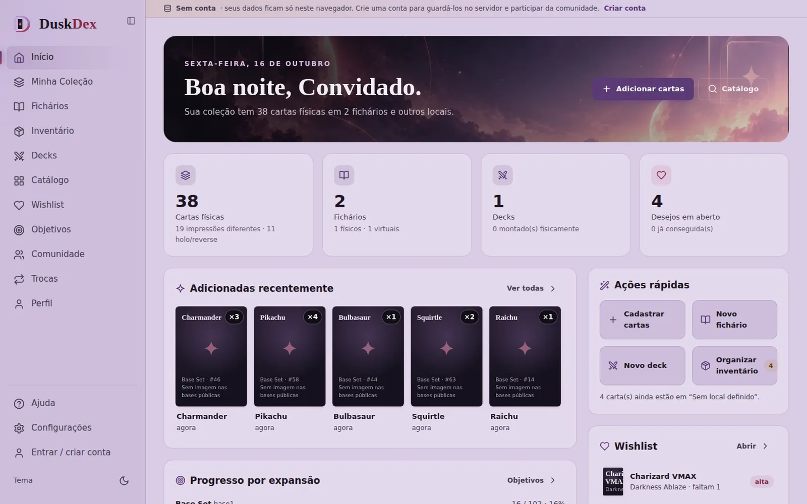
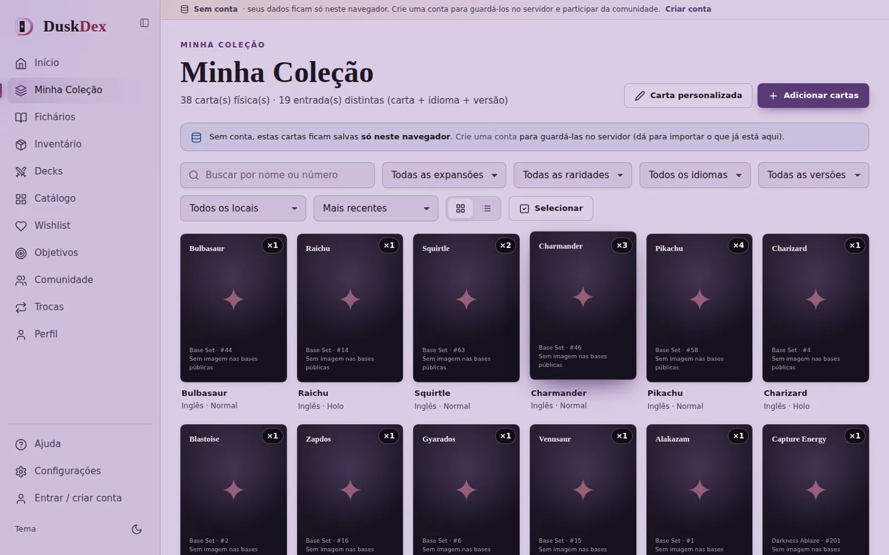
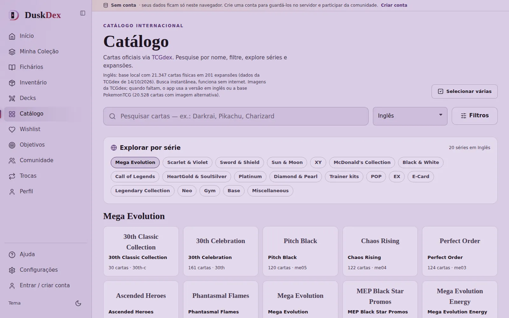
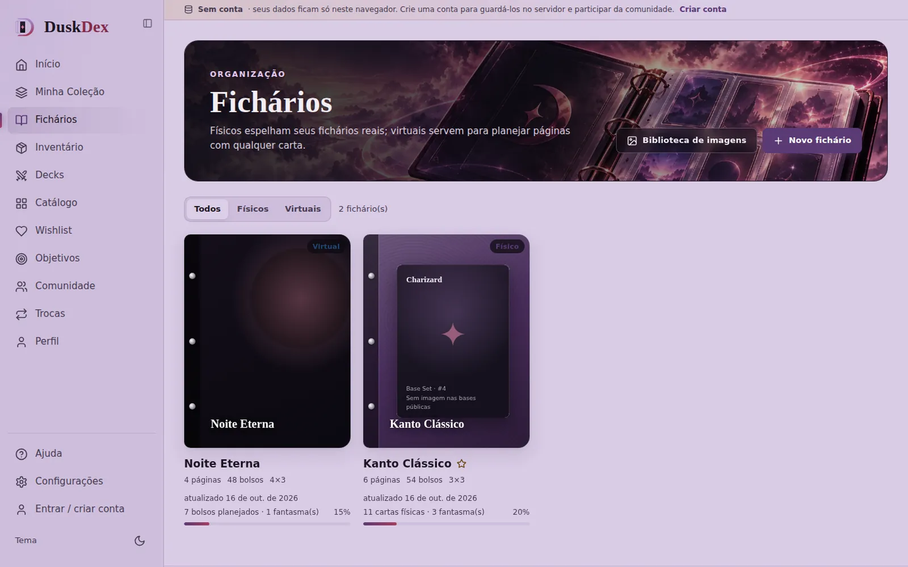

<p align="center">
  
</p>

<p align="center">
  
  
  
  
  
  
  
</p>

<p align="center">
  <a href="https://lorenzo-or7.github.io/duskdex/"><b>🔗 Abrir a demo</b></a> &nbsp;•&nbsp; clique em <b>“Usar sem conta”</b>
</p>

<p align="center">
  
</p>

<table align="center">
  <tr>
    <td></td>
    <td></td>
  </tr>
  <tr>
    <td></td>
    <td></td>
  </tr>
</table>

<p align="center"><sub>Telas com a coleção de exemplo (fictícia).</sub></p>

> **Demo online (GitHub Pages):** roda no **modo sem conta**. A coleção fica no IndexedDB do seu navegador e o catálogo vem da API pública do [TCGdex](https://tcgdex.dev/), direto do navegador, sem chave. Login, comunidade e trocas precisam do backend PHP + MySQL (veja abaixo).

---

Plataforma para colecionadores de Pokémon TCG: catálogo internacional (TCGdex, 13 idiomas embutidos), coleção de cópias físicas, fichários físicos e virtuais, artes panorâmicas para impressão, inventário com histórico e reversão, decks com montagem física, wishlist, objetivos, comunidade e trocas entre colecionadores.

> Projeto independente, sem afiliação com Nintendo, Game Freak, Creatures ou The Pokémon Company. Dados de cartas: [TCGdex](https://tcgdex.dev/) (MIT). Imagens alternativas: [PokemonTCG](https://github.com/PokemonTCG/pokemon-tcg-data) (MIT).

## Executar

Requisitos: PHP 8.1+ (extensões `pdo_mysql`, `mbstring`, `fileinfo`, `zlib`; `curl` opcional) e MySQL 8 **ou** MariaDB 10.4+ (o do XAMPP serve).

```bash
cp .env.example .env                  # ajuste DB_* (e APP_URL)
php backend/bin/migrate.php           # cria/atualiza as tabelas (rode de novo após atualizar o projeto)
php -S 127.0.0.1:8080 server.php      # serve o site e a API /api/v1
# abra http://127.0.0.1:8080
```

Banco no MySQL/MariaDB (exemplo):

```sql
CREATE DATABASE duskdex CHARACTER SET utf8mb4 COLLATE utf8mb4_unicode_ci;
CREATE USER 'duskdex'@'localhost' IDENTIFIED BY 'sua-senha';
GRANT ALL ON duskdex.* TO 'duskdex'@'localhost';
```

### Windows / XAMPP, passo a passo

**Jeito rápido:** ligue o MySQL no painel do XAMPP e dê dois cliques em `iniciar.bat` (Mac/Linux: `./iniciar.sh`). Ele cria o `.env`, acha a porta do MySQL (3306, 3307…), cria o banco, liga o servidor e abre o navegador.

Passo a passo manual:

1. No painel do XAMPP, clique em **Start** no **MySQL** (o Apache não é necessário).
2. Copie `.env.example` para `.env` (já vem com `DB_USERNAME=root` e senha vazia, o padrão do XAMPP).
3. No terminal, dentro da pasta do projeto:
   ```
   C:\xampp\php\php.exe backend\bin\migrate.php
   C:\xampp\php\php.exe -S 127.0.0.1:8080 server.php
   ```
   O `migrate.php` cria o banco `duskdex` sozinho se ele ainda não existir.
4. Abra http://127.0.0.1:8080. Se algo estiver errado com o banco, a tela de entrada diz exatamente o quê (MySQL parado, usuário/senha, permissão).

**MySQL do XAMPP para logo depois do Start (“MySQL shutdown unexpectedly”)** — duas causas comuns:
- *Porta 3306 ocupada* por outro MySQL instalado no Windows: em “Netstat” do painel, veja se há algo na 3306; pare o serviço “MySQL” em `services.msc` (ou mude a porta em `my.ini` e use a mesma em `DB_PORT`).
- *Arquivos de dados corrompidos* (acontece depois de desligar o PC com o MySQL aberto): com o MySQL parado, renomeie `C:\xampp\mysql\data` para `data_old`, copie a pasta `C:\xampp\mysql\backup` e renomeie a cópia para `data`. Se você já tinha bancos seus, copie as pastas deles (e o arquivo `ibdata1`) de `data_old` para a nova `data`. Depois clique em Start.

### Publicar numa hospedagem (cPanel / FTP, sem terminal)

```bash
python3 tools/build-deploy.py      # gera dist-deploy/duskdex/ e dist-deploy/duskdex-hospedagem.zip
```

Envie a pasta `duskdex` por FTP (com arquivos ocultos visíveis, por causa do `.htaccess`) e abra `https://seu-dominio/duskdex/instalar.php`: ele verifica o servidor, pede os dados do MySQL, grava o `.env` (produção) e cria as tabelas. Depois de instalado, a mesma página (protegida pela senha do banco) aplica migrações novas e dá o papel de moderação. Funciona na raiz do domínio ou em subpasta; `backend/`, `storage/` e `.env` ficam bloqueados pelo `.htaccess`. Passo a passo para leigos: `COMO-INSTALAR.txt` dentro do pacote.

### Duas formas de usar

- **Com conta (servidor):** coleção, fichários, imagens, inventário e decks ficam no MySQL; inclui comunidade e trocas. Login com senha (Argon2id), sessão segura, CSRF, limites de tentativas, recuperação de senha e confirmação de e-mail.
- **Sem conta (neste navegador):** tudo fica no IndexedDB do navegador, sem login. Começa vazio; uma **coleção de exemplo** (fictícia, rotulada) pode ser carregada em Início ou em Configurações → Dados e modo. Ao criar conta ou entrar, o app oferece **importar** a coleção do navegador para a conta.

### E-mail (recuperar senha, confirmar e-mail)

Por padrão `MAIL_DRIVER=log` (**modo de teste**): nenhum e-mail é enviado; cada mensagem é gravada em `storage/mail/` (há uma cópia `.txt` legível com o link). Nesse modo, fora de produção, o aviso “Confirme seu e-mail” traz o botão **Confirmar agora**.

Para enviar de verdade pelo **Gmail**:
1. Ligue a verificação em duas etapas da conta Google e crie uma **senha de app** em myaccount.google.com/apppasswords (16 letras).
2. No `.env`: `MAIL_DRIVER=smtp`, `MAIL_HOST=smtp.gmail.com`, `MAIL_PORT=587`, `MAIL_ENCRYPTION=tls`, `MAIL_USERNAME=seuemail@gmail.com`, `MAIL_PASSWORD="a senha de app"`. O remetente passa a ser o próprio Gmail.
3. Teste: `php backend/bin/test-mail.php seu@email.com` — ele envia uma mensagem e, se falhar, diz o motivo (senha, conexão, certificados).

No Windows/XAMPP o DuskDex procura sozinho o arquivo de certificados do XAMPP; se ainda aparecer erro de “conexão segura”, defina `MAIL_CA_FILE=C:\xampp\apache\bin\curl-ca-bundle.crt`. Em hospedagem (cPanel), `MAIL_DRIVER=mail` costuma funcionar sem configuração (é o que o instalador usa). Se um envio falhar, o site mostra o erro em vez de dizer que enviou.

### Estado de conservação e trocas

Cada cópia física tem um estado de conservação — **M** (Mint), **NM** (Near Mint), **SP** (Slightly Played), **MP** (Moderately Played), **HP** (Heavily Played), **D** (Damaged) ou **HD** (Hard Damaged) —, escolhido ao cadastrar e editável na página da carta. Ao marcar cópias para troca, o DuskDex pede para confirmar o estado de cada uma; quem se interessa vê o estado em cada carta da proposta. O estado fica registrado na proposta: se o dono mudar o estado depois, a troca não pode ser aceita até uma nova proposta.

### Moderação

Denúncias de publicações, comentários e perfis vão para uma fila de moderação (`#/moderacao`). Para dar o papel de moderação a uma conta:

```bash
php backend/bin/make-admin.php <username>          # --remove para tirar
```

### Catálogo de cartas

Base local embutida em `frontend/data/catalog/<idioma>/` (gzip): **13 idiomas** com cartas na TCGdex — inglês, francês, espanhol, espanhol (México), italiano, português (Brasil), alemão, japonês, coreano, chinês tradicional e simplificado, indonésio e tailandês (pt-pt, nl, pl e ru existem na API da TCGdex, mas sem nenhuma carta). Busca instantânea e sem internet; o servidor também valida as cartas por esta base.

Imagens: TCGdex no idioma da carta → a mesma carta em inglês → base PokemonTCG (≈96% das cartas em inglês mapeadas). Logos e símbolos de expansão seguem a mesma ordem. Legalidade Standard/Expanded por carta vem da lista pública da TCGdex.

Para atualizar a base:

```bash
git clone --depth 1 https://github.com/tcgdex/cards-database.git /tmp/cards-database
git clone --depth 1 https://github.com/PokemonTCG/pokemon-tcg-data.git /tmp/pokemon-tcg-data
node tools/build-catalog.mjs /tmp/cards-database --ptcg /tmp/pokemon-tcg-data
```

### Prévia online

`python3 tools/build-preview.py` gera `dist-preview/`, a versão publicada como link de demonstração. A página publicada não acessa a internet nem tem servidor: funciona sem conta, com o catálogo embutido; imagens das cartas, contas, comunidade e trocas aparecem rodando o projeto.

### Testes

```bash
npm run test:unit    # regras de domínio (Node 18+)
npm run test:api     # API com MySQL/MariaDB reais (servidor rodando; 79 verificações)
npm run test:e2e     # Playwright + Chromium (servidor rodando; inclui duas contas trocando cartas)
```

## Estrutura

```
server.php                 roteador do servidor embutido (/api/v1 → backend, resto → frontend)
frontend/
  js/api/                  index.js (ponto único de dados), demo-adapter (navegador), server-adapter (conta),
                           community (comunidade/trocas), catalog-local + tcgdex (catálogo)
  js/pages/                uma tela por arquivo, carregada sob demanda
  data/catalog/            base local de cartas por idioma
backend/
  src/Kernel               HTTP, banco, segurança (sessão, CSRF, rate limit), e-mail
  src/Modules              Auth, Users (perfil, importação), Catalog, Collection, Inventory, Binders, Decks,
                           Wishlist, Assets (imagens), Community (posts, perfis, notificações, moderação), Trades
  migrations/              001_init.sql, 002_complete.sql
  bin/                     migrate.php, make-admin.php, reset-rate-limits.php
storage/                   imagens enviadas e e-mails em modo log (fora da pasta pública; não versionado)
tests/unit · tests/e2e · backend/tests
```

## Regras e garantias

- **Uma cópia, um lugar:** cada carta física é uma linha no banco; um bolso aceita no máximo uma cópia (`UNIQUE` no banco + verificação na transação).
- **Histórico imutável:** toda movimentação gera registro; reverter cria uma operação compensatória (cada movimento só pode ser revertido uma vez) e conflitos são detectados.
- **Trocas atômicas:** ao aceitar, todas as cópias são travadas e conferidas; quem entrega tem a cópia retirada da coleção e quem recebe ganha uma cópia nova — os dois lados ficam com o registro no histórico. Não há pagamento nem envio pela plataforma.
- **Privacidade:** perfis e fichários públicos nunca mostram e-mail, localização física, inventário ou ids de cópias. Imagens enviadas têm EXIF/GPS removido e são privadas, exceto quando usadas no perfil ou em fichário público/não listado. Bloquear alguém esconde perfis e publicações nos dois sentidos e cancela trocas pendentes.
- **LGPD:** exportação dos dados em JSON e exclusão da conta (com senha) em Configurações → Conta.

## Observações

- A legalidade em torneios segue a lista pública da TCGdex; confira o anúncio oficial de rotação e banimentos antes de competir.
- **Logo minimalista** (`duskdex-mark.svg`): adaptação geométrica provisória; a logo original está preservada em `assets/logos/original/`.
- **Lançamento (hospedagem):** ative o SSL/HTTPS no painel; envie a pasta e abra `instalar.php` logo em seguida (ele grava `APP_ENV=production` e `APP_DEBUG=false`); teste “Esqueci a senha” para confirmar que os e-mails chegam; com e-mail funcionando, considere `REQUIRE_VERIFIED_EMAIL=true` (só contas confirmadas publicam); faça backup periódico do banco e da pasta `storage`.
- **Segurança já ativa no pacote:** Content-Security-Policy (só scripts do próprio site; imagens só das bases de cartas), `backend/`, `storage/` e `.env` bloqueados, sem listagem de pastas, erros do PHP só no log, limites de tentativas e um teto geral de escritas por conta (`RATE_WRITES_PER_HOUR`).

---

## 👨‍💻 Autor

<p>
  Feito por <b>Lorenzo Orsetti</b><br/>
  <a href="https://lorenzo-or7.github.io">
    
  </a>
  <a href="https://www.linkedin.com/in/lorenzo-orsetti-031906349/">
    
  </a>
  <a href="https://github.com/lorenzo-or7">
    
  </a>
</p>

<p align="center">
  
</p>
